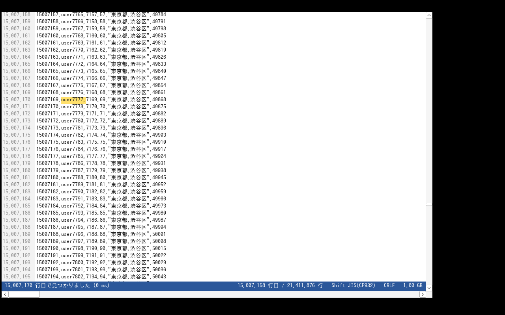
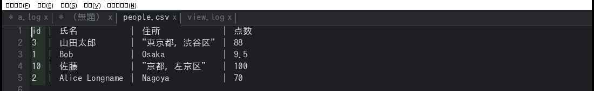
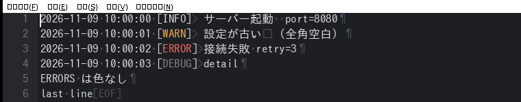
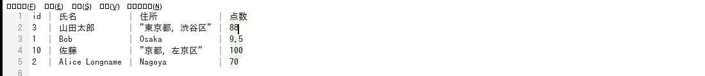

# kazakiri（風切）

[](https://github.com/c0dei/kazakiri/actions/workflows/ci.yml)

数GBのログ・CSV・TSV・テキストを一瞬で開いて編集できる、Windows 向けの軽量テキストエディタ（開発中）。
EmEditor の「大きいファイルが速い」体験を、買い切り不要のオープンソースで目指す。



## いまできること（v0.8）

### タブ（複数ファイル）
- 複数のファイルをタブで開く。Ctrl+O・ドラッグ&ドロップ（複数可）・コマンドライン引数（複数可）・GREP の結果からは新しいタブで開く
- すでに開いているファイルは、そのタブへ移るだけ（二重には開かない）
- スクロール位置、選択、編集の履歴（元に戻す）、CSV モード、末尾の追従はタブごとに保つ
- タブはドラッグで並べ替えられる。引数なしで起動すると、前回開いていたファイルとタブの並びを復元する
- 未保存のタブは名前の前に `*`。終了するときは、未保存のタブを順に表示して確認する（キャンセルすれば何も閉じない）



### 編集
- 数GBのファイルでもそのまま編集（ピーステーブル：元ファイルはコピーせず、変更部分だけを持つ）
- カーソル移動（矢印、Ctrl+矢印で単語、Home/End、PgUp/PgDn、Ctrl+Home/End）、Shift で範囲選択
- 入力、改行（ファイルの改行コードに合わせる）、Backspace / Delete、Tab
- 上書きモード（Insert キーで切り替え）：入力が、カーソルの次の 1 文字（全角も 1 文字）を置き換える。行末では挿入。ステータスバーに「上書き」と出て、カーソルがブロックになる
- 切り取り・コピー・貼り付け、元に戻す・やり直し（連続入力はまとめて戻る）
- 日本語入力（IME の変換位置をカーソルに合わせる。確定文字列はまとめて挿入）
- IME の変換中の文字は、IME の窓ではなくエディタの中（カーソルの位置）に描く。変換対象の文節は背景と太い下線、そのほかは細い下線。表示メニューの「IME の変換中の文字をエディタ内に表示」でオフにでき、オフなら IME 標準の窓に戻る（`settings.ini` の `ime_inline`）
- ファイルの文字コード（Shift_JIS など）のまま保存。表せない文字（Shift_JIS での絵文字など）は入力時に止める
- ファイルの分割・結合（ファイルメニュー）：分割は「1000000」（行数）や「512MB」（サイズ）で指定し、必ず行の境目で切る（`名前.part001.拡張子`）。CSV モードで見出し行があれば、2 つ目以降にも見出しを付ける（BOM も）。結合は複数のファイルを選んで 1 つにつなぐ（BOM の重複を取り除き、改行で終わっていないファイルの継ぎ目に改行を足す）。数GB でもメモリは一定で、進捗の表示と中止ができる
- 上書き保存・名前を付けて保存（別スレッドで書き出すので大きなファイルでも止まらない）
- 文字コード・改行コードを変えて保存（ファイルメニュー。UTF-8 / BOM 付き / Shift_JIS / EUC-JP / UTF-16、CRLF / LF / CR。数GBでもストリームで変換し、新しい文字コードで表せない文字があれば置き換えずに止める）
- 開くダイアログで複数のファイルを選ぶと、それぞれタブで開く
- タブを閉じる・終了する・文字コードを変えて開き直すときに、未保存の変更を確認

### 表示の設定
- ダークテーマ（表示メニュー。タイトルバー・スクロールバー・ポップアップメニュー・メニューバーも暗くなる。メニューバーは Windows 標準のものを、非公開メッセージ WM_UAHDRAWMENU で暗く塗る）
- 空白・タブ・改行の表示（Ctrl+Shift+W）：空白は `･`、全角空白は `□`、タブは `>` と桁送り、改行は CRLF が `¶`・LF が `↓`・CR が `←`、ファイルの終わりは `[EOF]`
- ログレベルの色分け：ERROR / FATAL は赤、WARN は橙、DEBUG / TRACE は灰（単語として現れたものだけ。既定でオン）
- 構文の色分け（表示 → 構文の色分け。既定でオン）：拡張子から言語を決め、文字列・数値・キーワード・コメント・タグ・キーに色を付ける。対象は JSON・SQL・XML/HTML・INI/設定ファイル・YAML・C 系（js ts java c cpp cs go rs php など）・# 系（py sh rb ps1 など）。1 行ずつ色を付けるので、数 GB のファイルでも見えている行だけのコストで、複数行にわたる文字列やコメントは追わない。CSV モードと、拡張子で言語が決まらないファイル（ログなど）では、ログレベルの色分けのまま
- 文字の大きさ：Ctrl++ / Ctrl+- / Ctrl+0（標準に戻す）、Ctrl+ホイール
- 折り返して表示（表示 → 折り返して表示）：長い行を画面の幅で折り返す。文字単位の折り返しで、スクロールは元の行を単位に行う。オンのあいだは横スクロールバーと矩形選択は使えない（キー割り当て名は `wrap`）
- 行の操作（編集 → 行の操作：複製 Ctrl+Shift+D・削除 Ctrl+Shift+K・上下へ移動 Ctrl+Shift+↑↓・行頭／行末まで削除・インデント Tab／逆インデント Shift+Tab・行末の空白削除・重複行の削除・昇順／降順に並べ替え）、日付・時刻の挿入、「変換」メニュー（大文字／小文字、全角⇔半角、半角カナ⇔全角カナ、ひらがな⇔カタカナ、タブ⇔空白。選択範囲、なければファイル全体）。どれも 1 回の Undo で戻せる
- EmEditor を参考にした追加（v0.11）：
  - 検索：行フィルター（Ctrl+Shift+L またはモードバーの「行フィルター」。検索語を入力して Enter で、一致した行だけを新しいタブに出す）、最長／最短の行を検索、頻出する行の抽出（回数付きで新しいタブに）、比較のオプション（行頭・行末の空白／大文字小文字を無視）
  - 行の並べ替え：数値・文字数・出現回数・IPv4 アドレス・逆順・ランダム（編集 → 行の操作 → 並べ替えの種類）
  - 挿入：上／下に空行（Ctrl+Shift+Enter / Ctrl+Enter 相当はメニュー）、連番（開始値,増分,桁数）、CR+LF・LF・CR・タブ
  - 変換：行頭の空白削除、各単語の頭を大文字、HTML の文字参照⇔文字、Base64、URL エンコード／デコード
  - ブックマーク：反転、ブックマークした行の切り取り・コピー・削除・新しいタブへの抽出
  - 分割表示の同期スクロール、CSV の列を A, B, C… で表示（状態表示）
  - 本文の右クリックメニュー（マーカー・フィルター・変換・行の操作・ブックマーク・CSV・挿入・検索）
  - CSV の並べ替え・列フィルタの対象の列は、モードバー右端の「対象の列: 3: email」のドロップダウンで選ぶ（CSV メニューの「対象の列を選ぶ」でも同じ）。見出し行の列名をクリックしても選べる。何も選ばなければ、カーソルのある列に合わせる。対象の列は、本文で薄い緑に強調される
- （以前の説明）CSV の並べ替え・列フィルタの使い方：固定した見出し行の列名をクリックすると、その列が「対象の列」になる（モードバーに「対象の列: 3/7 「email」」と出る）。そのうえで、モードバーの「列で昇順／降順」「列フィルタ」を押す。列フィルタは、ステータスバーの上に入力欄が出て、対象の列と「: 」（含む）が入っているので、続けて値を入力して Enter
- モードバー（ツールバーの 2 行目：CSV・カンマ・タブ・セミコロン・パイプ・見出し・列で並べ替え・列フィルタ・フィルター）
  - 通知領域（タスクトレイ）のアイコン：左クリックで「新規作成・貼り付けて新規作成・引用付き貼り付け・開く・ファイルから検索・最近使ったファイル／フォルダー・ワークスペース・すべて保存して閉じる・すべて閉じる」、右クリックで「最後のメッセージ・設定・最小化・開いているタブの一覧・アイコンを閉じる」
- メニューの整理：「検索」から GREP と検索結果をサブメニューへ、CSV の操作は新しい「CSV」メニューへまとめた（表示メニューは表示の切り替えだけ）
- 差分表示（検索 → 他のタブと比較。いまのタブと別のタブを左右に並べ、違う行を色分け。片方にしかない行は反対側を空ける。F8／Shift+F8 で次／前の違い、Esc で閉じる。数万行の違いまで）、分割表示（表示 → 分割表示。同じファイルを左右 2 つの窓で別々にスクロールして参照）
- カラーマーカー（検索 → カラーマーカー。選んだ文字列、なければカーソルの単語を 6 色でマーク。Ctrl+Shift+M で黄色。もう一度で外れる。ファイル内の同じ文字列すべてに色が付く）
- ステータスバーのクリック操作の追加（行・桁→行へ移動、タブ幅→2/3/4/8、挿入／上書き→切り替え）
- 編集メニューの追加：JSON の整形（展開）と圧縮（変換メニュー）、クリップボード履歴（編集 → クリップボード履歴。コピー・切り取り・貼り付けした 20 件）、単語補完（Ctrl+Space。ファイル内の単語を近い順に。続けて押すと次の候補）
- ツールバー（メニューバーの下。新規・開く・保存・元に戻す・切り取り／コピー／貼り付け・検索／置換／GREP・ブックマーク・折り返し／空白／CSV。アイコンは線で自前描画なのでダークテーマでも崩れない。マウスを乗せて少し待つと、ボタンの下に説明（ツールチップ）が出る）と、機能ボタンの列（ステータスバーの上。検索・置換・行へ移動・ブックマーク・表示の切り替え）。どちらも表示メニューか設定ダイアログでオン／オフ
- ブックマーク（検索 → ブックマーク。Ctrl+F2 で設定／解除、F2 で次、Shift+F2 で前、Ctrl+Shift+F2 で全解除、一覧は結果パネルに出る。行番号の欄に色の帯。行を足し引きしても印がずれて付いてくる。タブごと）
- ステータスバーの文字コード・改行コードをクリックすると、いまのファイルを開き直す／変換して上書き保存するメニューが出る（秀丸のように）
- キー割り当ては専用のウィンドウ（ファイル → キー割り当て）で、コマンドを選んでキーを押すだけで変えられる（keys.ini は自動で書く）
- ウィンドウの位置・大きさ・最大化は、終了時に覚えて、次の起動で戻す（settings.ini の window）。どのモニターにも掛からない位置なら既定の位置
- 本文のフォントが等幅でない場合（Noto Sans JP など）、CSV/TSV の表示のあいだだけ、列がそろうよう既定の等幅フォント（BIZ UDゴシック → MS ゴシック → Consolas）に自動で替える。CSV でなくなれば元のフォントに戻る
- フォントは 2 系統：本文（font / font_size）と、画面の部品＝メニュー・タブ・ツールバー・ステータスバー（ui_font / ui_font_size。既定は Yu Gothic UI → Meiryo UI → Segoe UI）。設定ダイアログで別々に変えられる
- 設定ダイアログ（ファイル → 設定）で、外観・編集・表示の主な項目を画面から変えられる（Mica のオン／オフ、フォント、タブ幅など）
- 設定は `%APPDATA%\kazakiri\settings.ini` に自動で保存（font, font_size, dark, whitespace, log_colors, tab_width, wrap, grep_backup, ime_inline, syntax, mica, toolbar, fkeys, ui_font, ui_font_size, window。テキストエディタで直接編集もできる）



### CSV / TSV
- 拡張子が .csv / .tsv なら自動で CSV/TSV モード（それ以外も Ctrl+Shift+C で切り替え）
- 列をそろえて表示（全角は 2 文字分として揃える）。区切り文字は自動判定、表示メニューで変更も可
- カーソルのある列を強調し、ステータスバーに「何列目か」と見出し（1 行目）の名前を表示
- 見出し（1 行目）を上に固定して表示する。スクロールしても列名が見える（「1 行目は見出し」を切ると固定も外れる）
- カーソルの列で並べ替え（昇順・降順。数値は数値として比べる。見出し行は先頭に残す。500 万行まで。Ctrl+Z で戻せる）
- 500 万行を超えるファイルは、並べ替えた結果を別のファイルに書き出す（外部ソート：200 万行ずつ並べて一時ファイルに書き、最後にマージするので、メモリは行数に比例しない。保存先を選ぶと、終わったあとに新しいタブで開く。元のファイルは変えない）
- 引用符の中に改行を含むレコード（1 つのセルが複数行にわたる CSV）に対応：前の行から続く行は、列に分けず薄い色でそのまま表示し（列の幅にも数えない）、列フィルタは複数行のレコードを 1 件として調べる（一致は複数行をまとめて選択）。続きの行の一覧は、CSV モードにしたあとファイルを先頭から 1 回読んで別スレッドで求める（数 GB なら数秒かかり、できるまでは通常の表示）。編集すると行番号がずれるので、編集中は通常の表示に戻る。並べ替えは、レコードを壊さないよう断る（どの行から続くかを表示）
- 列フィルタ（表示 → 列フィルタ。`3 = ERROR`・`2 : 含む語`・`4 >= 100`・`1 ~ 正規表現`・`5 empty` の形で条件を書くと、合う行を結果一覧に出して F8 で巡回できる。複数 GB でも並列で走査）
- 引用符で囲んだフィールドの中の区切り文字は区切りとみなさない（引用符の中の改行には未対応）



### 検索・置換・GREP
- 検索・置換・GREP のダイアログ（Ctrl+F / Ctrl+H / Ctrl+Shift+F）：1 つのウィンドウにタブ（検索・置換・GREP）。開いたまま本文を編集できる。検索語はコンボボックスで履歴から選べる。オプション（大文字小文字・正規表現・選択範囲の中だけ・GREP のフォルダ／ファイル／サブフォルダ／バックアップ）をそのまま選べる。ダークテーマでは暗くなる
- 検索語・置換語の履歴：ダイアログのコンボボックスで過去の語を選べる。検索語と置換語は別々に最大 100 件ずつ、`%APPDATA%\kazakiri\history.txt` に保存
- 結果の一覧（全件検索・GREP）では、一致した部分を黄色の背景で強調する。「検索 → 結果の一覧を新しいタブに出す」で無題のタブに、「結果の一覧をファイルに保存」で UTF-8（CRLF）のファイルに出せる
- 単語単位の検索（ダイアログの「単語単位」）：前後が単語の文字でないところだけに一致する。`foo` で `foobar` や `barfoo` を除く。正規表現でも全体を単語で囲む
- 置換（Ctrl+H）：1 件ずつ確認しながら、またはすべて置換。正規表現では `$1` `${name}` や `\n` `\t` が使える
- 選択範囲の中だけを置換：複数行を選んでから Ctrl+H を押すと、その範囲の中だけが対象になる（ステータスバーに [選択範囲内] と出る。Enter で範囲内をまとめて置換し、Ctrl+Z で 1 回で戻せる）。1 行だけの選択は、いままでどおり検索語の初期値になる
- すべて置換は 1 回の編集として適用し、Ctrl+Z 1 回でまとめて戻せる（3GB のログで 840 万件を約 1.6 秒）
- すべて検索して一覧（検索欄で Alt+Enter）：下のパネルに一覧を出し、クリックや F8 / Shift+F8 で移動
- GREP（Ctrl+Shift+F）：フォルダ内（サブフォルダも）のファイルをまとめて検索。ファイルごとに文字コードを判定するので、
  Shift_JIS・UTF-8・UTF-16 が混ざっていても同じ検索語で見つかる。隠しフォルダ（.git など）とバイナリは飛ばす
- GREP の結果を置換（検索 → GREP の結果を置換）：結果にあるファイル（タブで開いていないもの）を直接書き換える。実行前に確認が出る（既定は「いいえ」）。**既定では、書き換える前の内容を「ファイル名.bak」として同じフォルダに残す**（すでにあれば .bak2、.bak3 …で、上書きしない）。バックアップは「検索 → GREP 置換の前にバックアップ」でオフにでき、オフのときは元に戻せない。文字コード・改行コードは各ファイルのまま。結果が打ち切られているときは実行できない。開いているタブのファイルは対象外（そちらは Ctrl+H の置換で、Ctrl+Z で戻せる）

### 閲覧

- 数GBのファイルを即座に表示（メモリマップ + バックグラウンド行インデックス）
- 文字コード自動判定：UTF-8 / UTF-8 BOM / UTF-16LE・BE（BOM 有無）/ Shift_JIS(CP932) / EUC-JP
- 1 行が数MB ある巨大な行（minify した JSON や 1 行ログなど）も、横スクロールで最後まで読める。64KB を超える行は、横の位置に合わせた窓（画面の幅の 3 倍ほど）だけを取り出して描くので、行がどれだけ長くても描画のコストは一定。スクロールバーは行の長さまで伸び、ページ送り（バーの空き）は画面の幅ずつ進む（1 桁 ≒ 1 バイトで位置を決める）。長い行の途中でのカーソル移動の横追従・編集は未対応
- 文字コードを指定して開き直す（エンコードメニュー）
- 改行コード判定：CRLF / LF / CR
- 行番号表示、縦横スクロール、マウスホイール（Shift+ホイールで横）
- 検索：前方・後方（端まで行ったら反対側から続ける）、大文字小文字の区別、正規表現。別スレッドで並列に探すので UI は止まらない（Esc で中止）
- マウスでの選択（ドラッグ、Shift+クリック、ダブルクリックで単語、行番号クリックで行）とコピー
- 行番号ジャンプ（Ctrl+G）、再読み込み（F5）、末尾の追従（Ctrl+T、tail -f 相当）。追記だけなら増えた分だけ読み込む
- メニューバー、最近使ったファイル
- ドラッグ&ドロップ、コマンドライン引数、Ctrl+O で開く
- ステータスバー：索引・検索の進捗、選択サイズ、行位置、文字コード、改行コード、サイズ

## 計測結果（Linux 上でコアを計測。ページキャッシュに載った状態）

| ファイル | 行数 | 先頭画面の表示 | 全行索引 | ジャンプ+60行取得 | 全文検索 | 消費メモリ（RssAnon） |
|---|---|---|---|---|---|---|
| 3GB UTF-8 ログ | 3,359万 | 0.9 ms | 0.21 秒 | 9 µs | 17 GB/s | 約 2 MB |
| 1GB Shift_JIS CSV | 2,141万 | 11 ms | 0.09 秒 | 10 µs | 9 GB/s | 約 3 MB |

全文検索は「大文字小文字を区別する文字列検索」の値（4 コア）。大文字小文字を区別しない検索や正規表現は、
UTF-8 なら同程度（3GB ログで 8〜18 GB/s）。Shift_JIS などは一度デコードしてから探すので 0.7〜1 GB/s。

ファイル本体は OS のページキャッシュに置かれ、アプリ固有のメモリはほぼ増えない。
初回（ディスクから読む）の索引時間はディスク速度に依存する（NVMe SSD なら数GB/秒）。

## ダウンロード（ビルド不要）

GitHub Actions が Windows 用の実行ファイルを自動でビルドしている。

- 最新の開発版：[Actions](https://github.com/c0dei/kazakiri/actions/workflows/ci.yml) で main の一番新しい成功した実行を開き、
  下の「Artifacts」から `kazakiri-windows-x64` をダウンロード（GitHub へのログインが必要）
- リリース版：`v` で始まるタグ（例：`v0.3.0`）を push すると [Releases](https://github.com/c0dei/kazakiri/releases) に zip が付く

### セキュリティソフトについて

exe にはアイコン・バージョン情報・マニフェスト（管理者権限は要求しない）を埋め込んである。
コードは署名していないため、企業のセキュリティソフト（Defender、CrowdStrike Falcon など）では
「未署名で出回りの少ない exe」として警告されることがある。その場合は配布元の SHA256 を確認したうえで、
管理者にハッシュを許可リストへ登録してもらう。プロセス注入・フック・外部通信・レジストリ書き込みなどは使っていない。
ただしダークテーマのメニュー・スクロールバーのために、uxtheme.dll の非公開関数（序数 133・135・136）を `GetProcAddress` で呼ぶ
（Notepad++ など多くのアプリが使っているのと同じ方法）。

## ビルド

Windows で。事前に次の 2 つを入れておく。

1. Rust（[rustup](https://rustup.rs/)）
2. Visual Studio Build Tools の「C++ によるデスクトップ開発」（リンカー `link.exe` のため）

```
winget install Microsoft.VisualStudio.2022.BuildTools --override "--quiet --wait --add Microsoft.VisualStudio.Workload.VCTools --includeRecommended"
```

インストール後、ターミナルを開き直してからビルドする。

```
cargo build --release
target\release\kazakiri.exe 開きたいファイル.log
```

`link.exe not found` と出たら 2. が入っていない。GNU 版ツールチェーン（`x86_64-pc-windows-gnu`）を使う場合は
MinGW の `dlltool.exe` が別途必要（windows クレートが使うため）。

Linux からのクロスビルド:

```
rustup target add x86_64-pc-windows-gnu
sudo apt-get install gcc-mingw-w64-x86-64
cargo build --release --target x86_64-pc-windows-gnu -p kazakiri-win
```

ベンチマーク（どの OS でも可）:

```
cargo run --release -p kazakiri-cli -- gen big.log 3072 log     # 3GB のテストログを作る
cargo run --release -p kazakiri-cli -- open big.log "ERROR"     # 開く・索引・検索の時間を測る
```

## キー操作

ほとんどのコマンドの割り当ては変えられる。「ファイル → キー割り当てを編集」で `%APPDATA%\kazakiri\keys.ini` が
開く（初回は既定の割り当てを書いた雛形ができる）。`find = Ctrl+E` のように書いて保存し、再起動すると反映される
（割り当てを外すときは `none`、複数はカンマ区切り）。書式のまちがいは起動時にステータスバーへ出る。

| キー | 動作 |
|---|---|
| Ctrl+N / Ctrl+O | 新しいタブ / ファイルを開く（新しいタブで） |
| Ctrl+Tab / Ctrl+Shift+Tab | 次のタブ / 前のタブ |
| Alt+ドラッグ / Alt+Shift+矢印 | 矩形選択（コピー・切り取り・削除・貼り付け・各行への同時入力） |
| Ctrl+クリック | カーソルを増やす（マルチカーソル） |
| Ctrl+D | いまの選択（なければカーソルの下の単語）と同じ文字列を、次の位置に追加して選ぶ。入力・削除・コピー・切り取り・貼り付けは全カーソルに作用し、←→・Home・End も全カーソルが動く。Esc で 1 つに戻る |
| Ctrl+W（タブの x、中ボタンでも可） | タブを閉じる |
| Ctrl+S / Ctrl+Shift+S | 上書き保存 / 名前を付けて保存 |
| Ctrl+Z / Ctrl+Y | 元に戻す / やり直し（Ctrl+Shift+Z でもやり直し） |
| Ctrl+X / Ctrl+C / Ctrl+V | 切り取り / コピー / 貼り付け |
| Ctrl+A | すべて選択 |
| ← → ↑ ↓ / Ctrl+← → | カーソル移動 / 単語単位（Shift で選択） |
| Home / End | 行頭（インデントの後ろと交互）/ 行末 |
| Ctrl+Home / Ctrl+End | ファイルの先頭 / 末尾 |
| PgUp / PgDn | 1 画面ぶん移動 |
| Ctrl+↑ / Ctrl+↓ | カーソルを動かさずにスクロール |
| F5 | 再読み込み（追記だけなら増えた分だけ読み込む） |
| Ctrl+T | 末尾の追従（tail -f 相当）のオン・オフ |
| Ctrl+F | 検索ダイアログ（検索タブ）を開く |
| F3 / Shift+F3 | 次を検索 / 前を検索 |
| Alt+C / Alt+R | 大文字小文字の区別 / 正規表現 の切り替え（ダイアログのチェックボックスにも反映される） |
| Esc | 検索・保存の中止、選択の解除 |
| Ctrl+G | 行番号へ移動 |
| Ctrl+H | 検索ダイアログの置換タブ（複数行を選んでいれば「選択範囲の中だけ」を使える） |
| Ctrl+Shift+F | 検索ダイアログの GREP タブ（フォルダ・対象ファイル `*.log;*.txt` など） |
| F8 / Shift+F8 | 一覧の次 / 前の結果へ |
| Ctrl+Shift+C | CSV/TSV モードの切り替え（並べ替えは「表示」メニュー） |
| Ctrl+Shift+W | 空白・タブ・改行の表示の切り替え |
| Ctrl++ / Ctrl+- / Ctrl+0 / Ctrl+ホイール | 文字の拡大 / 縮小 / 標準 / 拡大縮小 |

コピー・切り取りは 256MB まで。編集は行インデックスの作成が終わってから（数GBでも 1 秒前後）。
編集中は再読み込み・末尾の追従はできない。

正規表現は Rust の [regex](https://docs.rs/regex/) の書き方。`^` `$` は行頭・行末にマッチし、一致は 1 行の中に限る。

フォントは BIZ UDゴシック → MS ゴシック → Consolas の順に探す。環境変数 `KAZAKIRI_FONT` で指定できる。

## 構成

```
crates/
  kazakiri-core/   UI に依存しないコア（テスト・ベンチ可能）
    source.rs      メモリマップでファイルを開く
    encoding.rs    文字コード判定・デコード
    line_index.rs  並列・疎な行インデックス
    document.rs    行の取り出し、編集（新しい Document を返す）、保存
    pieces.rs      ピーステーブル
    editor.rs      元に戻す・やり直す、変更の有無
    search.rs      並列検索（文字列・大文字小文字無視・正規表現、前方・後方、全件、置換後の文字列）
    grep.rs        フォルダ内のファイルの検索
    csv.rs         CSV / TSV のフィールド分割、区切り文字の判定、表示幅、並べ替え
  kazakiri-win/    Windows UI（Win32 + Direct2D/DirectWrite）
    app.rs         ウィンドウ、描画、検索、選択
    app/edit.rs    カーソル移動、入力、IME、保存
    app/results.rs 置換、結果一覧パネル、GREP
    app/csv_view.rs CSV / TSV の表示、列の強調、並べ替え、空白の可視化、ログの色分け
    app/theme.rs   明るい・暗いテーマの配色
    app/view.rs    文字の大きさ、テーマ、表示の切り替え
    app/tabs.rs    タブ（複数ファイル）、タブバー
  （kazakiri-win/src/settings.rs  設定ファイルの読み書き）
  kazakiri-cli/    ベンチマーク・テストデータ生成
docs/PLAN.md     調査結果と開発ロードマップ
```
